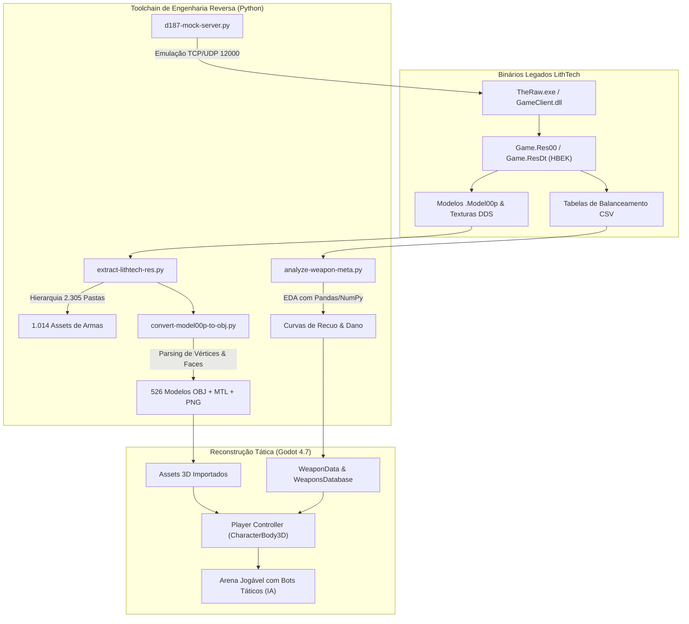

# District 187: Sin Streets — Engine Reverse Engineering & Modern Tactical Remake

[](https://godotengine.org/)
[](https://www.python.org/)
[](https://ghidra-sre.org/)
[](https://github.com/Gleidisonjr)

> **Engenharia Reversa de Baixo Nível, Análise Exploratória de Balanceamento e Reconstrução Tática em Godot 4** do clássico FPS coreano *District 187: Sin Streets* (CJ Games / Netmarble, Engine LithTech Jupiter EX).

---

## 🎯 Visão Geral do Projeto

Este repositório documenta uma investigação aprofundada de **Engenharia Reversa (RE)**, **Data Analytics** e **Desenvolvimento de Jogos**:

1. **Desempacotamento de Formatos Proprietários:**
   - Reversão da estrutura de arquivos de arquivo `HBEK` (`Game.Res00` / `Game.ResDt`), decodificando a hierarquia interna de 2.305 pastas e 13.824 arquivos indexados.
   - Decodificação de malhas 3D proprietárias `.Model00p` para o padrão aberto Wavefront OBJ + MTL, com normalização de buffers de vértices de passo ímpar e extração contígua de submeshes.
   - Conversão de texturas DirectDraw Surface (DXT5 / BC3) para PNG de alta fidelidade.
2. **Análise de Dados de Balanceamento (Data Analytics):**
   - Extração e modelagem das matrizes de armas (`WeaponInfo.csv`) para calcular Time-To-Kill (TTK), Shots-To-Kill (STK), cadência de disparo (RPM) e recuo procedural.
3. **Engenharia de Binários & Desarme de Trojans:**
   - Desarme de proxy DLL (`D3DX9_43.dll`) em clientes legados que injetavam módulos ofuscados (`TheRawExt.dll`), restaurando a integridade original de inicialização com binários autenticados do DirectX 9.
   - Mapeamento de rotinas de login Joygame (`0x2359f1`) e implementação de mock server local em Python (`Hermit Mock Server`) na porta 12000.
4. **Remake Tático Offline em Godot 4.7:**
   - Reconstrução completa de uma arena de combate tática jogável com as malhas 3D e texturas originais (AK-47, M4A1, AWM-300).
   - Sistema de IA de Bots táticos autônomos (`TacticalBot`) com máquina de estados, visão por Linha de Visada (LoS), rajadas táticas, multiplicador de headshot (2.5x) e respawn dinâmico.
   - Sistema de balística raycast, recuo procedural com recuperação elástica, weapon sway e mira ADS.

---

## 🏗️ Arquitetura do Sistema



---

## 🕹️ Remake Tático (Godot 4.7)

O remake está localizado em [`projects/godot-fps/`](file:///C:/Users/dopamine/Desktop/Projetos/Reverse%20Engineering/projects/godot-fps/):

### Funcionalidades Implementadas
- **Controle First-Person Tático:** Movimento responsivo com física `CharacterBody3D`, caminhada, corrida (sprint), agachamento e salto.
- **Balística Autêntica:** Disparo via raycast com dispersão calculada dinamicamente conforme velocidade do jogador e modo de mira.
- **Recuo Procedural com Mola de Recuperação:** Ângulos de pitch e yaw autênticos extraídos de District 187 com recuperação elástica suave.
- **IA Tática dos Bots (`TacticalBot`):**
  - Estados: `PATROL` (patrulha dinâmica via `NavigationAgent3D`), `CHASE` (perseguição ao perder alcance), `ENGAGE` (combate em linha de visada), `DEAD` (respawn com timer).
  - Headshots críticos (2.5x dano na região superior).
  - Feedback visual de acerto com material flashing vermelho.
- **HUD Completo:** Retícula tática verde, contador de vida/saúde (100 HP), contador de munição pente/reserva, killfeed no topo e tela de respawn imediato via tecla de espaço.

### Como Executar o Jogo
Basta clicar duas vezes em [`launch_game.bat`](file:///C:/Users/dopamine/Desktop/Projetos/Reverse%20Engineering/projects/godot-fps/launch_game.bat) ou executar via terminal:

```powershell
& "C:\Users\dopamine\Downloads\Godot_v4.7.1-stable_win64.exe\Godot_v4.7.1-stable_win64.exe" --path "projects/godot-fps"
```

---

## 📊 Análise de Armas e Dados Extraídos

| Arma | Categoria | Dano Base | Cadência (RPM) | Recuo Vertical | TTK Ideal (s) | STK (100 HP) |
|---|---|---|---|---|---|---|
| **AK-47** | Fuzil de Assalto | 34.0 | 600 | 2.4° | 0.20s | 3 tiros |
| **M4A1** | Fuzil de Assalto | 28.0 | 680 | 1.6° | 0.26s | 4 tiros |
| **AWM-300** | Sniper Bolt-Action | 115.0 | 42 | 6.0° | 0.00s | 1 tiro (One-Shot) |

As tabelas completas de jogo extraídas encontram-se em [`targets/district-187/extracted/tables/`](file:///C:/Users/dopamine/Desktop/Projetos/Reverse%20Engineering/targets/district-187/extracted/tables/).

---

## 📁 Estrutura do Repositório

- `projects/godot-fps/`: Código fonte completo do FPS tático no Godot 4.7.
- `scripts/`:
  - [`extract-lithtech-res.py`](file:///C:/Users/dopamine/Desktop/Projetos/Reverse%20Engineering/scripts/extract-lithtech-res.py): Desempacotador da hierarquia HBEK LithTech.
  - [`convert-model00p-to-obj.py`](file:///C:/Users/dopamine/Desktop/Projetos/Reverse%20Engineering/scripts/convert-model00p-to-obj.py): Conversor em lote de modelos `.Model00p` e texturas DDS.
  - [`analyze-weapon-meta.py`](file:///C:/Users/dopamine/Desktop/Projetos/Reverse%20Engineering/scripts/analyze-weapon-meta.py): Análise estatística de dados de armas.
  - [`d187-mock-server.py`](file:///C:/Users/dopamine/Desktop/Projetos/Reverse%20Engineering/scripts/d187-mock-server.py): Servidor mock Joygame/Hermit (porta 12000).
- `notes/`: Notas técnicas estruturadas de descobertas de engenharia reversa.
- `targets/district-187/`: Metadados do alvo, especificações de protocolos e tabelas extraídas.
- `decisions.md`: Registro formal de decisões arquiteturais e técnicas.

---

## 👤 Autor
**Gleidison Carvalho**  
Senior Data Analyst na Meta  
GitHub: [@Gleidisonjr](https://github.com/Gleidisonjr)
