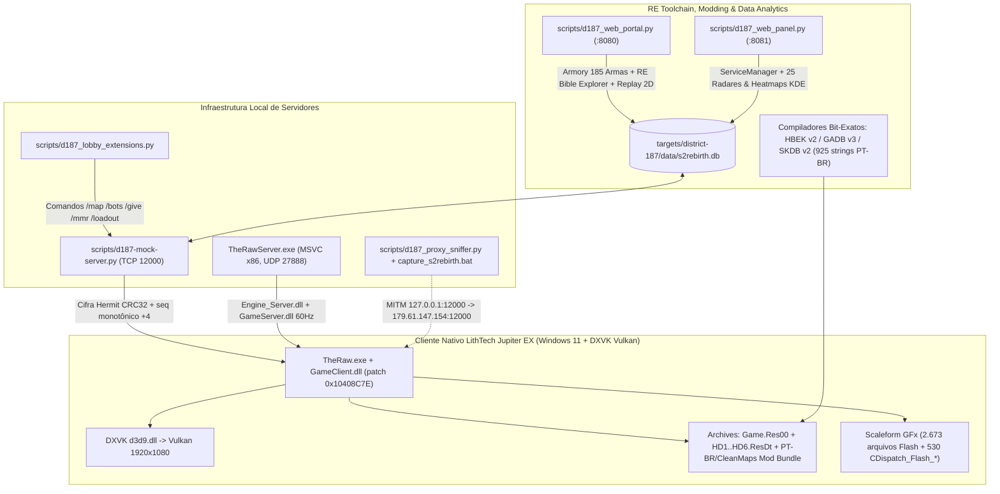

# District 187: Sin Streets — LithTech Jupiter EX Reverse Engineering, Native Dedicated Server & Preservation Suite

[](https://github.com/Gleidisonjr/district187-reverse-engineering)
[](https://www.python.org/)
[](https://ghidra-sre.org/)
[](https://github.com/Gleidisonjr/district187-reverse-engineering/actions)
[](https://github.com/Gleidisonjr)

> **Engenharia Reversa Integral do Motor Nativo LithTech Jupiter EX (`TheRaw.exe`, `GameClient.dll`, `Engine_Server.dll`, `GameServer.dll`), Emulação Autoritativa do Protocolo Cifrado Hermit (`TCP 12000`), Servidor Dedicado Nativo em C++ (`TheRawServer.exe`, `UDP 27888`), Compiladores Bit-Exatos (`HBEK`, `GADB v3`, `SKDB v2`) e Suíte de Telemetria Espacial** para preservação nativa do FPS tático *District 187: Sin Streets* (*S2 Online / S2 Son Silah / S2 Rebirth* — CJ GameLab / Netmarble).

---

## 🎯 Foco Atual e Status Real do Projeto

**Objetivo principal:** virar o jogo original de cabeça para baixo e destrinchar 100% do cliente e do servidor nativo até que uma partida 3D completa rode localmente em `TheRaw.exe` ↔ `TheRawServer.exe`.

| Etapa do Fluxo Real em Tela | Status | Detalhes Técnicos |
|---|---|---|
| **Boot Direct3D 9 (GPU moderna AMD/Win11)** | ✅ **100% Funcional** | DXVK v3.1.1 x86 (`d3d9.dll` → Vulkan 1920x1080) + 2.673 arquivos Scaleform Flash extraídos em `Interface\Flash\`. |
| **Remoção do Anticheat ApexGuard** | ✅ **100% Funcional** | `ApexGuard.dll` desativado, DLLs limpas restauradas, `.s2kl` (`0x1058C0A0`) e `CApexMgr::Start` (`0x10010750`) neutralizados. |
| **Handshake Hermit TCP + Login (`TCP 12000`)** | ✅ **100% Funcional** | Cifra de fluxo CRC32 (`0x802A58`, chave `0x0F`), seq monotônico `+4` (`Hermit::Session::Waiter::TCP @ 0x0050BB10`), `SA_JoyGameLogin (0x110112)` + `SN_LockEnd (0x210121)`. |
| **Canais → Lobby → Create Room → Sala de Espera** | ✅ **100% Funcional** | `SN_ServerInfo (0x220101)`, `SN_ChannelList (0x220102)`, patch de mapas (`0x10408C7E: 74 3f → 74 27`), `SN_Info (0x220203)`, `SN_UserList (0x220233)`, `SN_ChangeLeader (0x220319)`, Inventário/Loja (`0x240101..0x240104`), `/bots <N>`. |
| **Servidor Dedicado Nativo (`UDP 27888`)** | ✅ **100% Funcional** | `TheRawServer.exe` (MSVC x86) carregando `Engine_Server.dll` + `GameServer.dll`, `HostGame` slot `[25]`, `LTGUID {DF560590-D918-4A51-9CB1-38EBBE3879AD}`, `StartWorld('Worlds\Arrival.World00p')` com `req.m_pGameInfo = &pOpts` a 60Hz. |
| **Conexão UDP 3D (`F5` → `TheRawServer.exe`)** | ✅ **100% Funcional** | `CN_PlayStartButton (0x222103)` → `SN_BaseRoomInfo (0x222111)` → `SN_BaseUserList (0x222112, base_uid=0)` → `SN_HostConnect (0x420303)`. Partida completa de 10 minutos validada a 60Hz até `eClientConnectionState_GameEnd` com zero erros após fix do `Default.archcfg` (`\r\r\n` → `\r\n`). |
| **Render 3D & Loading Screen (`Scene 8 → 0xC`)** | 🔄 **Pronto para Validação ao Vivo** | Corrigidos em assembly: `CGameServerShell::SetCurLevel("Worlds\Arrival")` (`RVA 0x55D80`, sem `.World00p` → elimina `"Missing LoadingImage String"`), `GameServerNetMgr::m_bStandalone = 1` (`RVA 0x334D0`), `CServerMissionMgr::SetMissionState(1, true)` (`RVA 0xDEAA0`) e `base_uid = 0` em `SN_BaseUserList` (desbloqueia `HUD::CUserInfo::GetMyInfo()` em `CGameClientShell::Render @ 0x10234F60` e `CInGameLoadingHandler::Update @ 0x1016D520`). Ver [`notes/d187-black-screen-loading-scene-and-render3d-analysis.md`](notes/d187-black-screen-loading-scene-and-render3d-analysis.md) e [`notes/d187-gameserver-player-spawn-and-mission-state.md`](notes/d187-gameserver-player-spawn-and-mission-state.md). |

---

## 📥 Download do Cliente Base Funcional (S2 Rebirth)

O cliente funcional do **S2 Rebirth** (versão viva baseada no mesmo motor *LithTech Jupiter EX*) é a nossa base oficial de referência e engenharia reversa.

> **Nota sobre limites do GitHub:** O cliente completo descompactado ocupa **3,39 GB** (`targets/district-187/client-rebirth/`) e o arquivo `S2.rar` ocupa **969,6 MB** (o GitHub bloqueia arquivos acima de 100 MB em commits Git). Por isso, o **instalador oficial funcional (`S2RebirthKurulum.exe`, 833 KB)** está anexado diretamente na **GitHub Release** deste repositório e o cliente completo deve ser extraído em `targets/district-187/client-rebirth/` (já listado no `.gitignore`).

| Arquivo | Origem / Download Direto | Tamanho | SHA-256 |
|---|---|---|---|
| **`S2RebirthKurulum.exe`** *(Instalador Oficial)* | **[GitHub Release `v1.0.0-s2rebirth-base`](https://github.com/Gleidisonjr/district187-reverse-engineering/releases/tag/v1.0.0-s2rebirth-base)** · [Site Oficial (`https://s2rebirth.com/indir`)](https://s2rebirth.com/indir) | `852.992 B` (833 KB) | `CB6E1E970EB615587465B0E8056B6E409941CA1F83F90316D2C093B6DDC6E6CB` |
| **Portal Oficial S2 Rebirth** | [https://s2rebirth.com/](https://s2rebirth.com/) | — | Referência base funcional online |
| **`S2.rar`** *(Pacote Base Completo Local)* | Extraído em `targets/district-187/client-rebirth/` | `1.016.699.272 B` (969,6 MB) | `04510FCEFF04C8786A6A799497190FFEDA3CC72200F6D499F91E9F98BB38EBEC` |

### Estrutura esperada após instalar o cliente base
Coloque os arquivos instalados do cliente em `targets/district-187/client-rebirth/`:
```text
targets/district-187/client-rebirth/
├── TheRaw.exe               # Executável cliente LithTech Jupiter EX
├── TheRawServer.exe         # Nosso host dedicado nativo (gerado por build_server_host.bat)
├── Engine_Server.dll        # Motor servidor nativo LithTech
├── GameClient.dll           # Shell cliente (cópia sincronizada com Game\GameClient.dll)
├── d3d9.dll                 # DXVK v3.1.1 x86 (Vulkan bridge para GPUs modernas)
├── Default.archcfg          # Montagem de Game.Res00, Update_*.Res00, HD1..HD6.Res00
└── Game/
    ├── GameClient.dll
    ├── GameServer.dll
    ├── Worlds/              # 29 mapas .World00p extraídos (Arrival.World00p, twoway, thebank...)
    ├── Database/            # TheRaw.Gamdb00p (GADB v3)
    └── StringDatabase/      # TheRaw.Strdb00p (SKDB v2)
```

---

## 🏗️ Arquitetura do Ecossistema



---

## 🔬 Linha do Tempo Completa da Investigação, Implementações e Mudanças

### 1. Protocolo de Rede Hermit (`TCP 12000`) & Desbloqueio do Cliente Nativo
- **Cifra de fluxo Hermit (`TheRaw.exe @ 0x802A58`):** polinômio IEEE 802.3 CRC32 (`0xEDB88320`), chave inicial `0x0F`, máquina de estados `0x20080 → 0x20081 → 0x20082 → 0x20083`, Keepalive `0x20084` e ApexGuard Heartbeat `0x5A0101 → 0x5A0102`.
- **Sequência Monotônica (`Hermit::Session::Waiter::TCP @ 0x0050BB10`):** descoberto na memória viva que o offset `+4` (`uint16` BE) do header Hermit precisa incrementar monotonamente (`1, 2, 3, ...`) para pacotes de jogo — resolvendo o `"Please wait..."` infinito.
- **326/326 Opcodes + 251 Handlers `CDispatch_*` + 38 Emissores:** mapeamento integral por micro-interpretação da árvore de switch x86 (`0x10057168..0x1005845D`) via [`scripts/map_district187_protocol.py`](scripts/map_district187_protocol.py) → [`targets/district-187/data/d187_protocol_schema.json`](targets/district-187/data/d187_protocol_schema.json).
- **Login → Canal → Lobby → Sala → Inventário/Loja:** `SA_JoyGameLogin (0x110112)`, `SN_UserInfo (0x210101)`, `SN_RankingInfo (0x210105)`, `SN_ItemList (0x210111)`, `SN_Record (0x210103)`, `SN_LockEnd (0x210121 → ChangeScene(0))`, `SN_GroupList (0x220107)`, `SN_ServerList (0x220108)`, `SN_ServerInfo (0x220101)`, `SN_ChannelList (0x220102)`, `SA_EnterUser (0x220112 → ChangeScene(2))`, `SN_Info (0x220203 → ChangeScene(3))`, `SN_UserList (0x220233, 49B/usuário, rank +0x02, state=1 +0x0C)`, `SN_ChangeLeader (0x220319)`, `NEquipment_SA_Open (0x240102 → ChangeScene(4/5/13))`.
- **Patch Cirúrgico de Mapas/Modos (`GameClient.dll`):** `0x10408C7E: 74 3f → 74 27` (`je 0x10408CA7`) populando todos os mapas e modos sem o pop-up `GDB Mission/Level DetailInfo` (causa raiz também resolvida de forma não-destrutiva no `GADB CleanMaps Patcher`).

### 2. Servidor Dedicado Nativo LithTech (`TheRawServer.exe`, `UDP 27888`)
- **Código-fonte MSVC x86:** [`targets/district-187/server_host/d187_server_host.cpp`](targets/district-187/server_host/d187_server_host.cpp) + [`build_server_host.bat`](targets/district-187/server_host/build_server_host.bat).
- **ABI de `Engine_Server.dll`:** `CreateServer(SI_VERSION=2)` (`RVA 0x62631`), vtable `0x10158BCC` (28 slots), **`HostGame` no slot `[25]`** → `CUDPDriver::HostSession`, `NetHost` UTF-16LE (`0x2050` bytes), `ServerGameOptions` VC10-safe via `SetGameInfo(&pOpts)`, e **`LTGUID` autêntico `{DF560590-D918-4A51-9CB1-38EBBE3879AD}`** extraído de `TheRaw.exe` (`CNetMgr+0x28`).
- **Checks de integridade de `GameServer.dll` superados:**
  1. `0x10034B92`: exige executável chamado **`TheRawServer.exe`** (`strstr(GetModuleFileNameA, "TheRawServer.exe")`).
  2. `0x10034C13..0x10034CB2`: calcula CRC32 de `<exeDir>\Game\GameClient.dll` e compara com o cliente — `build_server_host.bat` agora copia automaticamente `TheRawServer.exe` para `targets/district-187/client-rebirth/TheRawServer.exe`.
  3. **`StartWorld` (`Engine_Server.dll @ 0x10062259`)**: descobrimos que `StartWorld` chamava `SetGameInfo(req->m_pGameInfo, req->m_GameInfoLen)` zerando o `m_pGameInfo` anterior quando `req` era inicializado com `memset`. Corrigido passando `req.m_pGameInfo = &pOpts; req.m_GameInfoLen = sizeof(pOpts);`.
- **Hooks diagnósticos instalados em runtime:** `sm_WriteModelFiles` (`RVA 0x5DD7D`), `GameServerLog` (`RVA 0x5FA20`) e `KickClient` (`g_pLTServer + 0x54`).

### 3. Entrada 3D (`F5` → `OnEnterWorld` → `SMSG_UPDATE`)
- **Ordem verificada em assembly (`GameClient.dll`):** ao receber `CN_PlayStartButton (0x222103)` (`F5`), o servidor envia:
  1. `SN_BaseRoomInfo (0x222111 @ 0x10138BA0 → 0x10070240)` — grava `TeamMgr[+0x30/+0x31/+0x32]`.
  2. `SN_BaseUserList (0x222112 @ 0x100CB7B0)` — popula `BattleUserMgr ([0x10515708+0x84])` com stride `0x10E` (270 B/usuário).
  3. `SN_HostConnect (0x420303 @ 0x10138EE0)` — lê `TeamMgr[+0x30]` e chama `CMissionMgr::StartGameAsClient("127.0.0.1:27888")`.
  4. `SN_BattleStart (0x420310 @ 0x10138B60)` — confirmado `ret 4` (NO-OP) em `GameClient.dll`.
- **Mapeamento UDP `TheRaw.exe` (`0x0085C760`):** `pkt 6 = SMSG_LOADWORLD (0x0047E06A)`, `pkt 7 = SMSG_CLIENTOBJECTID (0x0047D5FE)`, `pkt 8 = SMSG_UPDATE (0x0047DB2D → 0x00414B76 → ReadObjectUpdates 0x004806DA)`, `pkt 10 = SMSG_UNGUARANTEEDUPDATE (0x0047DBFF)`, `pkt 13 = SMSG_MESSAGE (0x0047E309)`, `pkt 15 = SMSG_PRELOADLIST (0x0047E0E2)`, `pkt 24 = ModelSync (0x0047D6B7)`.
- **Mapeamento `GameServer.dll`:** 12 exports, 522 classes RTTI (`CGameServerShell`, `CPlayerObj`, `CServerMissionMgr_*`), despachante `CGameServerShell::OnMessage (0x1004FD70)` (`MID_*`, incluindo `MID 0xA8 → 0xA7`).

### 4. Formatos Binários LithTech Dissecados Byte-a-Byte (`diff = 0`) & Mod Bundle PT-BR
- **Containers `HBEK v2` (`.Res00` / `.ResDt`):** 13.824 arquivos extraídos (29 mapas `.World00p`, 585 modelos `.Model00p`, 54 CSVs, 901 áudios FMOD FSB5) + compilador [`scripts/pack_lithtech_res.py`](scripts/pack_lithtech_res.py).
- **Bancos `GADB v3` (`.Gamdb00p`):** parser + compilador bit-exato ([`scripts/inspect_gamdb00p.py`](scripts/inspect_gamdb00p.py), [`scripts/compile_gamdb00p.py`](scripts/compile_gamdb00p.py)) + CleanMaps patcher não-destrutivo (corrige os 6 registros legados `DetailInfo == 0` → `10000`).
- **Localização `SKDB v2` (`.Strdb00p` / `.Strdb00e`):** parser + compilador bit-exato ([`scripts/inspect_strdb00e.py`](scripts/inspect_strdb00e.py), [`scripts/compile_strdb00p.py`](scripts/compile_strdb00p.py)) + workflow CSV [`targets/district-187/data/ptbr_translations.csv`](targets/district-187/data/ptbr_translations.csv) com **925 strings PT-BR traduzidas (0 pendentes)** e empacotador 1-comando [`scripts/build_d187_mod_bundle.py`](scripts/build_d187_mod_bundle.py).
- **Texturas `DTX`/`DDS` & Shaders `Mat00`:** dissector DTX/DDS + catálogo de 301 shaders `Mat00`.
- **Ponte Scaleform GFx Flash ↔ C++:** 530 classes `CDispatch_Flash_*` resolvidas ([`scripts/map_scaleform_flash_bridge.py`](scripts/map_scaleform_flash_bridge.py)).

### 5. Captura MITM do S2 Rebirth (`capture_s2rebirth.bat`)
- [`capture_s2rebirth.bat`](capture_s2rebirth.bat) + [`scripts/capture_s2rebirth_session.py`](scripts/capture_s2rebirth_session.py) + [`scripts/d187_proxy_sniffer.py`](scripts/d187_proxy_sniffer.py) + [`scripts/analyze_s2rebirth_capture.py`](scripts/analyze_s2rebirth_capture.py).
- **Descoberta operacional:** `GameClient.dll` ignora `+gs_port` e sempre conecta em `127.0.0.1:12000` para o login Hermit; corrigido `PROXY_PORT = 12000` em `capture_s2rebirth_session.py` para interceptar corretamente o tráfego rumo a `179.61.147.154:12000`.

### 6. Telemetria Espacial, Analytics, MMR/DDA, Replay 2D & Ferramentas Secundárias
- **SQLite (`targets/district-187/data/s2rebirth.db`):** 185 armas com balística auditada vs `GADB`, 58 patentes, 25 radares táticos + NavMeshes A\* + Heatmaps 2D KDE ([`targets/district-187/analytics/index.html`](targets/district-187/analytics/index.html)), Replay 2D estilo HLTV ([`targets/district-187/analytics/match_replay.html`](targets/district-187/analytics/match_replay.html)), MMR/DDA ([`scripts/d187_mmr_engine.py`](scripts/d187_mmr_engine.py)), Web Portal (`:8080`, [`scripts/d187_web_portal.py`](scripts/d187_web_portal.py)) e Control Plane (`:8081`, [`scripts/d187_web_panel.py`](scripts/d187_web_panel.py)).
- **Dissectores Binários Pure-Python (frente secundária pausada até o 3D rodar):** Apache Parquet ([`scripts/parse_parquet_binary.py`](scripts/parse_parquet_binary.py)), Apache Arrow IPC ([`scripts/parse_arrow_ipc_binary.py`](scripts/parse_arrow_ipc_binary.py)), GGUF v3 ([`scripts/parse_gguf_binary.py`](scripts/parse_gguf_binary.py)), Safetensors ([`scripts/parse_safetensors_binary.py`](scripts/parse_safetensors_binary.py)) e ONNX Protobuf ([`scripts/parse_onnx_binary.py`](scripts/parse_onnx_binary.py)).

---

## 🚀 Como Iniciar o Ecossistema Local

### Opção 1: Launcher Gráfico Oficial (Recomendado)
Execute [`D187_Launcher.bat`](D187_Launcher.bat) na raiz do repositório:
- Sobe automaticamente **Hermit Mock Server (`TCP 12000`) + `TheRawServer.exe` (`UDP 27888`) + `TheRaw.exe`**.
- Permite configurar mapa, bots, modo Borderless Windowed (Alt+Tab instantâneo), Web Portal (`:8080`) e Replay 2D.

### Opção 2: Inicialização Direta (1-Clique)
Execute [`launch_game.bat`](launch_game.bat) para subir `d187-mock-server.py`, `client-rebirth\TheRawServer.exe` e `TheRaw.exe`. Na tela de login in-game, entre com **`gleidison`** + qualquer senha.

### Opção 3: Recompilar o Servidor Dedicado Nativo (`TheRawServer.exe`)
```cmd
cd targets\district-187\server_host
build_server_host.bat
```
Compila `d187_server_host.cpp` com MSVC x86 e copia automaticamente `TheRawServer.exe` para `targets\district-187\client-rebirth\TheRawServer.exe`.

### Comandos In-Game via Chat (`CQ_Chat 0x210151` → `SN_Chat 0x210152`)
`/help` · `/map <twoway|thebank|arrival|oldtown|killport|heaven>` · `/bots <1..16> [easy|med|hard|adaptive]` · `/give <arma>` · `/loadout <A|B|C>` · `/mmr` · `/clan`

---

## 🧪 Suíte Completa de Testes & Verificação

Todos os testes abaixo estão **100% verdes**:

```bash
# 1. Suíte de regressão da RE Toolchain (8/8 testes — 326 opcodes, 530 Flash handlers, 522 RTTI,
#    GADB v3 & SKDB v2 round-trip SHA-256 bit-exato, balística, UDP MID_*, ClientShell/CVars)
python scripts/test_re_toolchain.py

# 2. Teste E2E do protocolo Hermit TCP (Handshake CRC32 -> Login -> Canal -> Lobby -> Sala ->
#    Troca de time/mapa -> Loja -> F5 CN_PlayStartButton -> SN_BaseRoomInfo/BaseUserList/HostConnect -> /bots & /mmr)
python scripts/d187-mock-server.py --port 12199 &
python scripts/test_client_handshake_smoke.py 12199

# 3. Recompilação e validação bit-exata do Mod Bundle PT-BR (925 strings) + CleanMaps
python scripts/build_d187_mod_bundle.py

# 4. Self-test dos dissectores binários ML/Data (zero dependências externas)
python scripts/parse_onnx_binary.py --self-test
```

| Suíte | Resultado | Cobertura |
|---|---|---|
| `scripts/test_re_toolchain.py` | **8 / 8 PASS** | 326 opcodes, 530 `CDispatch_Flash_*`, 522 RTTI `GameServer.dll`, 5 bancos `GADB v3` (`diff=0`), `SKDB v2` SHA-256 round-trip, balística, `MID_*`, `ClientShell`/CVars. |
| `scripts/test_client_handshake_smoke.py` | **100% PASS** | Ciclo completo Login → Canal → Lobby → Sala → Time/Mapa/Loja → `F5` (`0x222111` + `0x222112` + `0x420303` + `0x420310`) → LeaveRoom → `/bots 3` & `/mmr`. |
| `scripts/build_d187_mod_bundle.py` | **PASS (`diff=0`)** | 925/925 traduções PT-BR (`SKDB v2`) + 6 correções CleanMaps (`GADB v3`) com manifesto SHA-256. |
| GitHub Actions CI (`re-toolchain-ci.yml`) | **PASS** | Executado automaticamente em todo push para `main`. |

---

## 📚 Índice Completo de Documentação Técnica (`docs/` & `notes/`)

### Manuais & Referências Master
- [`docs/MODDING_AND_ARCHITECTURE.md`](docs/MODDING_AND_ARCHITECTURE.md) — **Manual Unificado (Front-End, Back-End, Compiladores & Modding)**
- [`notes/d187-native-server-host-and-lobby-protocol-breakthroughs.md`](notes/d187-native-server-host-and-lobby-protocol-breakthroughs.md) — **Referência Master:** `Hermit::Session::Waiter::TCP`, `SN_Info`, `SN_HostConnect`, patch `0x10408C7E`, ABI `Engine_Server.dll` (`TheRawServer.exe`) e `LTGUID`
- [`notes/d187-3d-world-entry-and-onenterworld-analysis.md`](notes/d187-3d-world-entry-and-onenterworld-analysis.md) — **Entrada 3D & `OnEnterWorld`:** validação assembly de `0x222111`/`0x222112`/`0x420303`/`0x420310`, fix `StartWorld` (`req.m_pGameInfo`), `SMSG_UPDATE (0x0047DB2D)` e `ReadObjectUpdates (0x004806DA)`
- [`notes/d187-black-screen-loading-scene-and-render3d-analysis.md`](notes/d187-black-screen-loading-scene-and-render3d-analysis.md) — **Tela Preta & Render 3D (`GameClient.dll`):** causa raiz de `"Missing LoadingImage String"` (`0x1016D820`, `_splitpath` sem `.World00p`), gates de `CGameClientShell::Render (0x10234F60)` e `CInGameLoadingHandler::Update (0x1016D520)` (`HUD::CUserInfo::GetMyInfo()` exigindo `user_id = 0`)
- [`notes/d187-gameserver-player-spawn-and-mission-state.md`](notes/d187-gameserver-player-spawn-and-mission-state.md) — **Spawn & Estado da Missão (`GameServer.dll`):** `CGameServerShell::SetCurLevel (RVA 0x55D80)`, `GameServerNetMgr::m_bStandalone (RVA 0x334D0)`, `CServerMissionMgr::SetMissionState (RVA 0xDEAA0)` e `CPlayerObj::Respawn (0x1007C350)` (`PS_ALIVE` / `MID 0x60`)

### Protocolo de Rede, Sala, Login & Anticheat
- [`notes/district-187-full-network-protocol-specification.md`](notes/district-187-full-network-protocol-specification.md) — Especificação completa dos **326/326 opcodes** + 251 handlers `CDispatch_*`
- [`notes/d187-wait-room-user-list-and-leader-protocol.md`](notes/d187-wait-room-user-list-and-leader-protocol.md) — Sala de espera (`SN_UserList 0x220233`, `SN_ChangeLeader 0x220319`, `CN_PlayStartButton 0x222103`, Inventário/Loja `0x2401xx`)
- [`notes/d187-lithtech-udp-mid-protocol.md`](notes/d187-lithtech-udp-mid-protocol.md) — Protocolo UDP de combate (`MID_*`) em `GameServer.dll` (`OnMessage @ 0x1004FD70`)
- [`notes/d187-login-scaleform-unlock.md`](notes/d187-login-scaleform-unlock.md) — `IsPacketerrorMessage (0x10191740)` e `SN_LockEnd (0x210121)`
- [`notes/district-187-hermit-protocol-and-handshake.md`](notes/district-187-hermit-protocol-and-handshake.md) · [`notes/district-187-hermit-protocol-and-login-state-machine.md`](notes/district-187-hermit-protocol-and-login-state-machine.md) · [`notes/district-187-login-hang-root-cause-and-network-bypass.md`](notes/district-187-login-hang-root-cause-and-network-bypass.md)
- [`notes/d187-apexguard-removal-and-server-state-machine.md`](notes/d187-apexguard-removal-and-server-state-machine.md) · [`notes/d187-apexguard-s2-320-dx-proxy.md`](notes/d187-apexguard-s2-320-dx-proxy.md) · [`notes/d187-lt-errorcopyingfile-and-apex-mgr-patch.md`](notes/d187-lt-errorcopyingfile-and-apex-mgr-patch.md)

### Internals de Binários (`TheRaw.exe`, `GameClient.dll`, `GameServer.dll`, Scaleform)
- [`notes/d187-gameserver-dll-architecture-and-message-dispatch.md`](notes/d187-gameserver-dll-architecture-and-message-dispatch.md) — `GameServer.dll` (12 exports, 522 RTTI, vtables, checks `0x10034B92` / `0x10034C13`)
- [`notes/d187-scaleform-flash-to-cpp-dispatch-bridge.md`](notes/d187-scaleform-flash-to-cpp-dispatch-bridge.md) — Ponte Scaleform GFx Flash ↔ C++ (530 classes `CDispatch_Flash_*`)
- [`notes/d187-theraw-cvars-and-clientshell-vtable.md`](notes/d187-theraw-cvars-and-clientshell-vtable.md) · [`notes/lithtech-engine-cvars-and-competitive-tuning.md`](notes/lithtech-engine-cvars-and-competitive-tuning.md)
- [`notes/d187-gdb-mission-level-detailinfo-patch.md`](notes/d187-gdb-mission-level-detailinfo-patch.md) · [`notes/d187-master-map-and-mode-registry.md`](notes/d187-master-map-and-mode-registry.md)
- [`notes/district-187-client-internals-and-launch-hooks.md`](notes/district-187-client-internals-and-launch-hooks.md) · [`notes/district-187-network-and-launch-architecture.md`](notes/district-187-network-and-launch-architecture.md) · [`notes/district-187-dedicated-server-and-matchmaking-architecture.md`](notes/district-187-dedicated-server-and-matchmaking-architecture.md)

### Formatos Binários LithTech & Modding
- [`notes/lithtech-gamdb00p-database-format.md`](notes/lithtech-gamdb00p-database-format.md) (`GADB v3`) · [`notes/lithtech-strdb00e-localization-binary-format.md`](notes/lithtech-strdb00e-localization-binary-format.md) (`SKDB v2`)
- [`notes/lithtech-hbek-archive-format.md`](notes/lithtech-hbek-archive-format.md) · [`notes/lithtech-directory-tree-structure.md`](notes/lithtech-directory-tree-structure.md) · [`notes/resdt-archive-and-anti-cheat-decompilation-manifest.md`](notes/resdt-archive-and-anti-cheat-decompilation-manifest.md)
- [`notes/lithtech-world00p-format-and-map-entities.md`](notes/lithtech-world00p-format-and-map-entities.md) · [`notes/lithtech-model00p-format.md`](notes/lithtech-model00p-format.md) · [`notes/lithtech-dtx-texture-format.md`](notes/lithtech-dtx-texture-format.md)
- [`notes/district-187-multi-map-geometry-navmesh-and-audio-manifest.md`](notes/district-187-multi-map-geometry-navmesh-and-audio-manifest.md) · [`notes/district-187-modding-mmr-replay-and-qol-suite.md`](notes/district-187-modding-mmr-replay-and-qol-suite.md)

### S2 Rebirth, Balística & Spatial Analytics
- [`notes/s2-rebirth-client-architecture-and-hybrid-setup.md`](notes/s2-rebirth-client-architecture-and-hybrid-setup.md) · [`notes/s2-rebirth-hd-pack-and-web-portal-architecture.md`](notes/s2-rebirth-hd-pack-and-web-portal-architecture.md) · [`notes/phase-1-ultra-hd-textures-and-144fps-optimization.md`](notes/phase-1-ultra-hd-textures-and-144fps-optimization.md)
- [`notes/d187-gamdb-vs-sqlite-ballistics-audit.md`](notes/d187-gamdb-vs-sqlite-ballistics-audit.md) · [`notes/district-187-combat-and-damage-formula-specification.md`](notes/district-187-combat-and-damage-formula-specification.md) · [`notes/district-187-weapon-balance-analysis.md`](notes/district-187-weapon-balance-analysis.md) · [`notes/district-187-spatial-analytics-and-heatmaps.md`](notes/district-187-spatial-analytics-and-heatmaps.md)

### Dissectores Binários de Dados & ML (Frente Secundária)
- [`notes/parquet-columnar-binary-format-reverse-engineering.md`](notes/parquet-columnar-binary-format-reverse-engineering.md) · [`notes/arrow-ipc-binary-format-reverse-engineering.md`](notes/arrow-ipc-binary-format-reverse-engineering.md) · [`notes/ml-model-binary-formats-gguf-and-safetensors.md`](notes/ml-model-binary-formats-gguf-and-safetensors.md) · [`notes/onnx-protobuf-binary-format-reverse-engineering.md`](notes/onnx-protobuf-binary-format-reverse-engineering.md)

---

## 👤 Autor
**Gleidison Carvalho**  
Senior Data Analyst na Meta  
GitHub: [@Gleidisonjr](https://github.com/Gleidisonjr)
