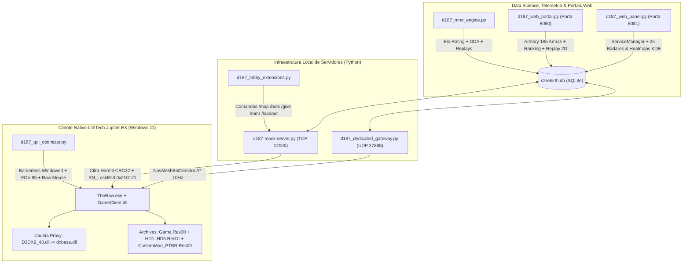

# District 187: Sin Streets — LithTech Jupiter EX Reverse Engineering, Server Emulator & Spatial Analytics Suite

> **Engenharia Reversa de Binários (`TheRaw.exe` / `GameClient.dll`), Emulação Autoritativa do Protocolo Cifrado Hermit (TCP 12000 & UDP 27888), Compilador de Containers `.Res00`/`.ResDt` (HBEK v2) e Telemetria Espacial 2D KDE / Replay estilo HLTV** para preservação nativa do FPS tático *District 187: Sin Streets* (*S2 Online / S2 Son Silah* — CJ GameLab / Netmarble).

---

## 🎯 Visão Geral da Arquitetura

Este repositório consolida a engenharia reversa completa do motor nativo **LithTech Jupiter EX** e sua infraestrutura de servidor e analytics:

1. **Protocolo de Rede Hermit & Desbloqueio do Cliente Nativo (`TCP 12000`):**
   - Reversão da cifra de fluxo proprietária Hermit em `TheRaw.exe` (`0x802a58`, polinômio IEEE 802.3 CRC32 `0xEDB88320`, chave `0x0F`) e máquina de estados de handshake (`0x20080` $\rightarrow$ `0x20081` $\rightarrow$ `0x20082` $\rightarrow$ `0x20083`, Keepalive `0x20084` e ApexGuard Heartbeat `0x5A0101` $\rightarrow$ `0x5A0102`).
   - Desmontagem completa das tabelas de despacho em `GameClient.dll` (`0x10194800` e `0x10132d10`), identificando `IsPacketerrorMessage(0, 0)` (`0x10191740`) e o pacote real de transição de cenas `SN_LockEnd` (`0x210121`), além de `SN_UserInfo` (`0x210101`), `SN_RankingInfo` (`0x210105`), `SN_ItemList` (`0x210111`, 27B/item), `SN_Record` (`0x210103`, 224B), `SN_ServerInfo` (`0x220101`, 98B) e `SN_ChannelList` (`0x220102`, 57B).
   - Mapeamento da cadeia de DLLs-proxy do `ApexGuard.dll` (`D3DX9_43.dll` 119 KB $\rightarrow$ `dxbase.dll`, `StringEditRuntime.dll` $\rightarrow$ `strbase.dll`, `GameDatabase.dll` $\rightarrow$ `dbbase.dll`), eliminando definitivamente o erro `S2-320` e o crash `R6025`.

2. **Extração e Re-Compilação de Containers Proprietários (`HBEK` `.Res00` / `.ResDt`):**
   - Extração integral de **13.824 arquivos** distribuídos em **2.305 diretórios** (`Game.Res00`/`Game.ResDt`), incluindo **29 mapas compilados (`.World00p`)**, **585 modelos 3D (`.Model00p` v33)**, **54 tabelas CSV** e **901 amostras de áudio FMOD FSB5**.
   - Compilador reverso [`scripts/pack_lithtech_res.py`](file:///C:/Users/dopamine/Desktop/Projetos/Reverse%20Engineering/scripts/pack_lithtech_res.py) que empacota traduções nativas PT-BR (`StringDatabase\Portuguese\Game.StrDb00e`), patches competitivos de balística e materiais customizados em containers `CustomMod_PTBR.Res00`/`.ResDt` verificados byte a byte.

3. **Geometria de Mapas (`.World00p`), Malhas de Navegação A\* e Gateway UDP (`27888`):**
   - Parser universal [`scripts/inspect_world00p.py`](file:///C:/Users/dopamine/Desktop/Projetos/Reverse%20Engineering/scripts/inspect_world00p.py) e gerador de grafos táticos A\* [`scripts/d187_navmesh_generator.py`](file:///C:/Users/dopamine/Desktop/Projetos/Reverse%20Engineering/scripts/d187_navmesh_generator.py) para as 25 arenas oficiais (`twoway`, `thebank`, `Arrival`, `oldtown`, `Kill_Port`, `Ghost_Ship`, `10025_Heaven`, etc.).
   - Gateway Dedicado UDP [`scripts/d187_dedicated_gateway.py`](file:///C:/Users/dopamine/Desktop/Projetos/Reverse%20Engineering/scripts/d187_dedicated_gateway.py) na porta `27888` com o `NavMeshBotDirector` transmitindo pacotes autoritativos (`SN_Spawn`, `SN_Move`, `SN_Hit`, `SN_Kill`) a 10Hz sobre os waypoints reais.

4. **Data Science, MMR Adaptativo (Elo/DDA), Heatmaps 2D KDE & Replay Tático (HLTV / Scope.gg):**
   - Banco de dados analítico SQLite (`targets/district-187/data/s2rebirth.db`) com 185 armas, 58 patentes, loadouts persistentes (Slots A/B/C com attachments), clãs, telemetria espacial de abates (`match_kills`) e cálculo de Elo + Dynamic Difficulty Adjustment ([`scripts/d187_mmr_engine.py`](file:///C:/Users/dopamine/Desktop/Projetos/Reverse%20Engineering/scripts/d187_mmr_engine.py)).
   - Suite de 25 Heatmaps de Combate 2D KDE ([`targets/district-187/analytics/index.html`](file:///C:/Users/dopamine/Desktop/Projetos/Reverse%20Engineering/targets/district-187/analytics/index.html)) e **Player Interativo de Replay 2D** ([`targets/district-187/analytics/match_replay.html`](file:///C:/Users/dopamine/Desktop/Projetos/Reverse%20Engineering/targets/district-187/analytics/match_replay.html)).

---

## 🏗️ Diagrama de Arquitetura

---

## 🚀 Como Iniciar o Ecossistema

### Opção 1: Launcher Gráfico Oficial (Recomendado)
Execute [`D187_Launcher.bat`](file:///C:/Users/dopamine/Desktop/Projetos/Reverse%20Engineering/D187_Launcher.bat) na raiz do repositório:
- Monitora e reinicia automaticamente o Servidor Hermit (`127.0.0.1:12000`).
- Permite escolher mapa, dificuldade dos bots (`Recruta`, `Veterano`, `Elite 187`), modo **Janela Sem Bordas (Instant Alt+Tab)**, abrir o **Web Portal (`:8080`)** e o **Player de Replay Tático 2D**.

### Opção 2: Inicialização Rápida Direta (1-Clique)
Execute [`launch_game.bat`](file:///C:/Users/dopamine/Desktop/Projetos/Reverse%20Engineering/launch_game.bat) para validar a porta `12000` e disparar `TheRaw.exe` em modo Ultra HD + 144Hz+.

### Comandos In-Game via Chat (`CQ_Chat` $\rightarrow$ `SN_Chat`)
Dentro do chat do lobby ou da sala, digite:
- `/help` — Lista todos os comandos ativos.
- `/map <twoway|thebank|arrival|oldtown|killport|heaven>` — Altera a arena da partida.
- `/bots <1..16> <easy|med|hard|adaptive>` — Configura os bots táticos.
- `/give <nome_da_arma>` — Equipa qualquer uma das 185 armas no slot ativo.
- `/loadout <A|B|C>` — Alterna entre os 3 slots de loadout persistentes.
- `/mmr` ou `/stats` — Exibe seu Elo Rating, Skill Tier, HS%, TTK e perfil DDA.
- `/clan` — Exibe o status e Elo do seu clã (`[META] Meta Data Science Ops`).

---

## 📚 Documentação Técnica (`notes/`)

- [`notes/d187-login-scaleform-unlock.md`](file:///C:/Users/dopamine/Desktop/Projetos/Reverse%20Engineering/notes/d187-login-scaleform-unlock.md) — Engenharia reversa de `IsPacketerrorMessage` (`0x10191740`), `SN_LockEnd` (`0x210121`) e transição de cenas Scaleform em `GameClient.dll`.
- [`notes/d187-apexguard-s2-320-dx-proxy.md`](file:///C:/Users/dopamine/Desktop/Projetos/Reverse%20Engineering/notes/d187-apexguard-s2-320-dx-proxy.md) — Análise da cadeia de DLLs-proxy (`dxbase.dll`, `strbase.dll`, `dbbase.dll`) do `ApexGuard.dll` e resolução do `S2-320` / `R6025`.
- [`notes/district-187-hermit-protocol-and-handshake.md`](file:///C:/Users/dopamine/Desktop/Projetos/Reverse%20Engineering/notes/district-187-hermit-protocol-and-handshake.md) — Cifra de fluxo Hermit CRC32 e máquina de estados TCP.
- [`notes/district-187-full-network-protocol-specification.md`](file:///C:/Users/dopamine/Desktop/Projetos/Reverse%20Engineering/notes/district-187-full-network-protocol-specification.md) — Especificação dos 326 pacotes das famílias `NLaunch`, `NMatchup`, `NHosting` e `NBattle`.
- [`notes/lithtech-hbek-archive-format.md`](file:///C:/Users/dopamine/Desktop/Projetos/Reverse%20Engineering/notes/lithtech-hbek-archive-format.md) & [`notes/lithtech-directory-tree-structure.md`](file:///C:/Users/dopamine/Desktop/Projetos/Reverse%20Engineering/notes/lithtech-directory-tree-structure.md) — Especificação binária dos containers `.Res00` e `.ResDt`.
- [`notes/district-187-multi-map-geometry-navmesh-and-audio-manifest.md`](file:///C:/Users/dopamine/Desktop/Projetos/Reverse%20Engineering/notes/district-187-multi-map-geometry-navmesh-and-audio-manifest.md) — Extração dos 29 mapas `.World00p`, grafos A\* e 9 SoundBanks FMOD FSB5.
- [`notes/district-187-spatial-analytics-and-heatmaps.md`](file:///C:/Users/dopamine/Desktop/Projetos/Reverse%20Engineering/notes/district-187-spatial-analytics-and-heatmaps.md) — Modelagem de densidade espacial 2D KDE e detecção de choke points nas 25 arenas.
- [`notes/district-187-modding-mmr-replay-and-qol-suite.md`](file:///C:/Users/dopamine/Desktop/Projetos/Reverse%20Engineering/notes/district-187-modding-mmr-replay-and-qol-suite.md) — Compilador HBEK `.Res00`/`.ResDt` (PT-BR), Motor MMR/DDA, Replay 2D (HLTV) e QoL Windows 11.
- [`notes/parquet-columnar-binary-format-reverse-engineering.md`](file:///C:/Users/dopamine/Desktop/Projetos/Reverse%20Engineering/notes/parquet-columnar-binary-format-reverse-engineering.md) — Dissecação binária do formato colunar Apache Parquet (Thrift Compact Protocol, LEB128/ZigZag).

---

## 👤 Autor
**Gleidison Carvalho**  
Senior Data Analyst na Meta  
GitHub: [@Gleidisonjr](https://github.com/Gleidisonjr)
