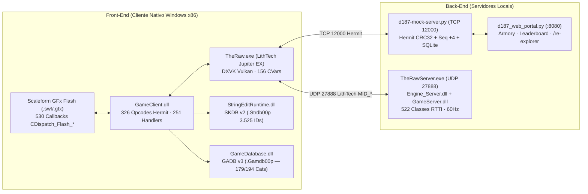

# District 187: Sin Streets — Bíblia Completa de Arquitetura, Engenharia Reversa & Modding

> **Manual Unificado (Front-End, Back-End, Binários, Protocolos e Compiladores)**  
> Repositório: [`Gleidisonjr/district187-reverse-engineering`](https://github.com/Gleidisonjr/district187-reverse-engineering)

---

## 1. Mapa Completo da Arquitetura (Front-End ↔ Back-End)



---

## 2. Front-End (`TheRaw.exe`, `GameClient.dll`, Scaleform GFx & Assets)

| Camada | Artefato / Script | Cobertura Validada |
|---|---|---|
| **Ponte Flash ↔ C++** | [`scripts/map_scaleform_flash_bridge.py`](../scripts/map_scaleform_flash_bridge.py) → [`notes/d187-scaleform-flash-to-cpp-dispatch-bridge.md`](../notes/d187-scaleform-flash-to-cpp-dispatch-bridge.md) | **530 / 530** classes `CDispatch_Flash_*` com `vtable_va` e `handler_va` (`fn1`) |
| **Localização (`SKDB` v2)** | [`scripts/inspect_strdb00e.py`](../scripts/inspect_strdb00e.py) + [`scripts/build_strdb00p.py`](../scripts/build_strdb00p.py) | `diff = 0` em 20 arquivos; compilador **SHA-256 bit-exato** + 67 traduções PT-BR |
| **GameDatabase (`GADB` v3)** | [`scripts/inspect_gamdb00p.py`](../scripts/inspect_gamdb00p.py) + [`scripts/build_gamdb00p.py`](../scripts/build_gamdb00p.py) | `diff = 0` e **SHA-256 bit-exato** nos 5 bancos `.Gamdb00p` (até 3,11 MB) |
| **Texturas & Materiais** | [`scripts/inspect_dtx_textures.py`](../scripts/inspect_dtx_textures.py) + [`scripts/inspect_mat00_materials.py`](../scripts/inspect_mat00_materials.py) | **459 texturas** (`DDS_DXT5/RGBA/DXT3/DXT1`) + **301 materiais `.Mat00`** (`18` shaders) |
| **ClientShell & CVars** | [`scripts/map_clientshell_and_cvars.py`](../scripts/map_clientshell_and_cvars.py) | Vtables-chave de `GameClient.dll` + **156 CVars** (`TheRaw.exe`) + **187 CVars** (`GameClient.dll`) |

---

## 3. Back-End (Protocolo Hermit TCP 12000 & LithTech Dedicated Server UDP 27888)

| Camada | Artefato / Script | Cobertura Validada |
|---|---|---|
| **Protocolo Hermit (TCP 12000)** | [`scripts/map_district187_protocol.py`](../scripts/map_district187_protocol.py) → [`notes/district-187-full-network-protocol-specification.md`](../notes/district-187-full-network-protocol-specification.md) | **326 / 326** opcodes hexadecimais (`0x110101`..`0x510203`), **251 handlers `CDispatch_*`**, **38 emissores** |
| **Sala de Espera, Líder & Loja** | [`notes/d187-wait-room-user-list-and-leader-protocol.md`](../notes/d187-wait-room-user-list-and-leader-protocol.md) + [`scripts/d187-mock-server.py`](../scripts/d187-mock-server.py) | `SN_Info (+0x1A=16)`, `SN_UserList (0x220233)`, `SN_ChangeLeader (0x220319)`, `CN_PlayStartButton (0x222103)`, `NEquipment_SA_Open (0x240102)` |
| **Arquitetura `GameServer.dll`** | [`scripts/map_gameserver_internals.py`](../scripts/map_gameserver_internals.py) → [`notes/d187-gameserver-dll-architecture-and-message-dispatch.md`](../notes/d187-gameserver-dll-architecture-and-message-dispatch.md) | **12 exports**, **522 classes RTTI**, vtable `CGameServerShell` (`0x1019220C`), checks `0x10034B92` e `0x10034C13` |
| **UDP Combate 3D (`MID_*`)** | [`scripts/map_lithtech_udp_messages.py`](../scripts/map_lithtech_udp_messages.py) → [`notes/d187-lithtech-udp-mid-protocol.md`](../notes/d187-lithtech-udp-mid-protocol.md) | Despachante `CGameServerShell::OnMessage` (`0x1004FD70`) |
| **Registro Mestre de Mapas** | [`scripts/build_master_map_registry.py`](../scripts/build_master_map_registry.py) → [`notes/d187-master-map-and-mode-registry.md`](../notes/d187-master-map-and-mode-registry.md) | **33 `.World00p`** em disco, **28 mapas pareados** com `DetailInfo` IDs e **20 modos** |

---

## 4. Comandos Rápidos da Toolchain (Modding, Testes & Explorer)

```powershell
# 1. Rodar a suíte completa de regressão RE (8 testes, ~0.4s)
python scripts\test_re_toolchain.py

# 2. Compilar o pacote de Mod (PT-BR + CleanMaps) sem alterar client-rebirth/
python scripts\build_d187_mod_bundle.py

# 3. Instalar o Mod Bundle com backup automático (.bak) ou reverter
python scripts\build_d187_mod_bundle.py --install
python scripts\build_d187_mod_bundle.py --rollback

# 4. Abrir o Web Portal + RE Bible Explorer (http://127.0.0.1:8080/re-explorer)
python scripts\d187_web_portal.py
```
