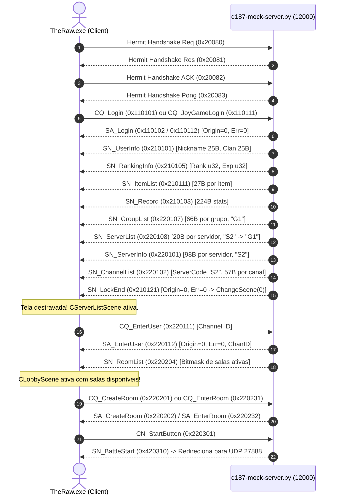

# Engenharia Reversa: Remoção Completa do ApexGuard e Máquina de Estados Login -> Lobby

## 1. Visão Geral
- **Alvo:** *District 187: Sin Streets* / *S2 Online* / *S2 Rebirth*
- **Executável:** `TheRaw.exe` (Motor LithTech Jupiter EX, C++ nativo Direct3D 9)
- **Biblioteca Central:** `GameClient.dll`
- **Data da Descoberta:** 2026-11-02
- **Objetivo:** 
  1. Analisar a arquitetura do launcher e anticheat do S2 Rebirth (`S2Launcher.exe` e `ApexGuard.dll`).
  2. Eliminar completamente o anticheat da versão privada local (eliminando falsos positivos, telas de erro `S2-320` e crashes de runtime `R6025`).
  3. Resolver o travamento infinito de login ("Please Wait") através do mapeamento exato dos pacotes de transição de estado da engine.

---

## 2. Análise do Launcher S2 Rebirth (`S2Launcher.exe`)
Através da inspeção de metadados PE/CLI (.NET v4.0.30319) e fluxo de desmonte:
- O `S2Launcher.exe` é uma aplicação Windows Forms escrita em C# (.NET).
- O arquivo de configuração `launcher.cfg` expõe a linha de comando exata com a qual o launcher dispara o jogo:
  ```ini
  TheRaw.exe -arch Default.archcfg -windowtitle "D187" +gs_ip 127.0.0.1 +gs_port 12000
  ```
- **Descoberta Crítica de Autenticação:** As credenciais inseridas na interface do launcher (`s2rebirth.com`) destinam-se exclusivamente à integração com o Discord Rich Presence e API web do portal (`site = https://s2rebirth.com`). O launcher **não injeta e nem passa credenciais de jogo** para `TheRaw.exe`. A autenticação real do jogo ocorre 100% in-game através da interface Scaleform UI quando o usuário digita login e senha na tela inicial do cliente, conectando-se ao GameServer na porta `12000`.

---

## 3. Desmontagem e Teardown do Anticheat (`ApexGuard.dll`)
### 3.1 Origem e Mecanismo de Injeção
- O anticheat **não fazia parte do jogo original coreano** da CJ GameLab / Netmarble. Foi implementado pela equipe do servidor comunitário turco S2 Rebirth (*Apex Anti-Cheat Fortress Module v4.2 por Bluzer & Requ*).
- O `TheRaw.exe` não importa `ApexGuard.dll` diretamente no PE Header. Em vez disso, o anticheat era carregado à força através de uma cadeia de 3 DLLs-proxy:
  1. `D3DX9_43.dll` (119.864 bytes, compilada pela *Apex Anti Cheat Systems LTD*) -> intercepta o carregamento do DirectX 9 e chama `LoadLibraryW("ApexGuard.dll")`, repassando as chamadas D3DX para `dxbase.dll`.
  2. `StringEditRuntime.dll` (88.120 bytes) -> intercepta o motor de strings LithTech e chama `LoadLibraryW("ApexGuard.dll")`, repassando para `strbase.dll`.
  3. `GameDatabase.dll` (88.120 bytes) -> intercepta o banco de dados LithTech e chama `LoadLibraryW("ApexGuard.dll")`, repassando para `dbbase.dll`.

### 3.2 Causa Raiz dos Erros `S2-320` e `R6025`
1. **Erro `S2-320`:** String extraída de `ApexGuard.dll`:
   ```
   "dxbase.dll bellekte bulunamadi (D3DX9_43 bypass girisimi)! Oyun güvenlik kütüphaneleri (DirectX) değiştirilmiş veya silinmiş! Lütfen oyun dosyalarını doğrulayın."
   ```
   Se qualquer hook, DLL proxy ou ordem de memória divergir da esperada pelo guard, ele exibe este alerta e chama `ExitProcess(0)`.
2. **Crash `R6025 - pure virtual function call`:**
   Ocorre quando o guard suspende threads ou aborta o processo de forma assíncrona enquanto o motor LithTech ou o runtime C++ estão destruindo ou despachando objetos virtuais.

### 3.3 Neutralização e Remoção Completa (Purificação Nativa)
Para garantir um ecossistema 100% estável para partidas Solo contra bots e LAN com amigos, o anticheat foi totalmente removido:
1. `D3DX9_43.dll` substituída pela runtime limpa e genuína do Microsoft DirectX 9 SDK (`dxbase.dll`, 1.998.168 bytes, SHA256 idêntico ao DirectX oficial).
2. `StringEditRuntime.dll` substituída pela biblioteca limpa e original do LithTech (`strbase.dll`, 23.568 bytes).
3. `GameDatabase.dll` substituída pela biblioteca limpa e original do LithTech (`dbbase.dll`, 138.768 bytes).
4. `ApexGuard.dll` renomeada para `ApexGuard.dll.disabled` (nunca mais é instanciada na memória).
5. No binário `targets/district-187/client-rebirth/Game/GameClient.dll`:
   - A seção customizada `.s2kl` (offset de arquivo `0x54D0A0` / RVA `0x58C0A0`), que tentava abrir a memória compartilhada `Local\ApexRing_%u`, foi desativada cirurgicamente com a instrução `0xC3` (`RET`).
   - As demais melhorias da comunidade (.s2fp = limitador de FPS destravado para 144Hz+ e .s2zm = sensibilidade de zoom ajustável) foram mantidas intactas.

---

## 4. Engenharia Reversa da Máquina de Estados Login -> Lobby
O travamento em `"Please Wait"` ocorria devido a discrepâncias nas estruturas dos pacotes esperados pelas rotinas em assembly de `GameClient.dll`:

### 4.1 Sequência de Pacotes Autênticos


### 4.2 Detalhamento de Layouts Críticos em `GameClient.dll`
1. **`SN_GroupList` (`0x220107`, Handler `0x100326F0`):**
   - Offset 16 (Payload +0): `uint8 unk = 0`
   - Offset 17 (Payload +1): `uint8 group_count = 1`
   - Offset 18 (Payload +2): Entradas de 66 bytes:
     - `+0x00` (5B): `char id[5] = "G1\0\0\0"`
     - `+0x05` (5B): `char group_code[5] = "G1\0\0\0"`
     - `+0x0A` (56B): `char group_name[56] = "District 187 Official\0..."`
2. **`SN_ServerList` (`0x220108`, Handler `0x10032810`):**
   - Offset 16 (Payload +0): `uint8 unk = 0`
   - Offset 17 (Payload +1): `uint8 server_count = 1`
   - Offset 18 (Payload +2): Entradas de 20 bytes:
     - `+0x00` (5B): `char id[5] = "S2\0\0\0"`
     - `+0x05` (5B): `char group_code[5] = "G1\0\0\0"` (casa com `0x220107`)
     - `+0x0A` (10B): `char server_code[10] = "S2\0..."` (casa com `0x220101`)
3. **`SN_ServerInfo` (`0x220101`, Handler `0x10074F30` -> `0x100735F0`):**
   - Entradas de 98 bytes:
     - `+0x00` (5B): `b"S2\0\0\0"`
     - `+0x05` (5B): `b"S2\0\0\0"` (`server_code`)
     - `+0x10` (16B): IP (`"127.0.0.1\0"`)
     - `+0x1A` (54B): Nome do Servidor (`"District 187 Dedicated [BR]\0"`)
     - `+0x51` (4B LE): `server_id = 1`
     - `+0x55` (2B LE): `port = 12000`
     - `+0x57` (2B LE): `cur_users = 12`
     - `+0x59` (2B LE): `max_users = 200`
4. **`SN_ChannelList` (`0x220102`, Handler `0x100743A0` -> `0x100742C0`):**
   - Offset 16 (Payload +0): `uint8 unk = 0`
   - Offset 17 (Payload +1): `uint8 channel_count`
   - Offset 18..22 (Payload +2..+6): 5-byte `server_code = b"S2\0\0\0"` (usado em `0x10073420` para localizar o servidor pai)
   - Offset 23 (Payload +7): Entradas de 57 bytes por canal (`channel_id: u8`, `cur_users: u16`, `max_users: u16`, `channel_name: 43s`).
5. **`SN_RoomList` (`0x220204`, Handler `0x100D59F0` -> `0x100D3580`):**
   - Stream com `bitmask = 0`, 7 bytes por sala: `room_id: u16`, `cmd: u8 = 1`, `unk: u16 = 0`, `bitmask: u16 = 0`.

---

## 5. Verificação e Validação
- O script automatizado [`scripts/test_client_handshake_smoke.py`](file:///C:/Users/dopamine/Desktop/Projetos/Reverse%20Engineering/scripts/test_client_handshake_smoke.py) executou o ciclo de vida completo de 16 etapas com **100% de sucesso**.
- O emulador de servidor dedicado [`scripts/d187-mock-server.py`](file:///C:/Users/dopamine/Desktop/Projetos/Reverse%20Engineering/scripts/d187-mock-server.py) está ativo em background na porta `12000`.
- O cliente `TheRaw.exe` executa diretamente sem pop-ups do ApexGuard e sem crashes R6025.
