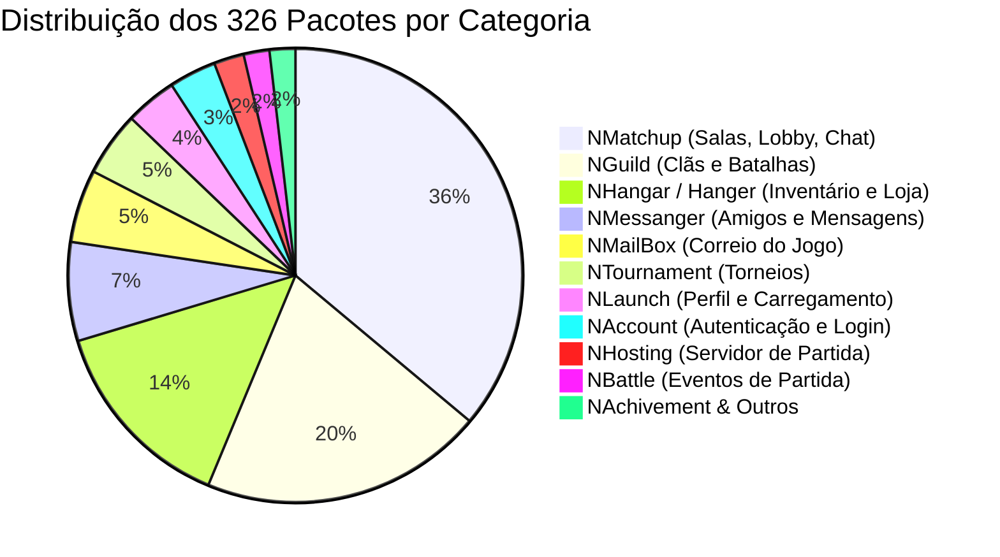
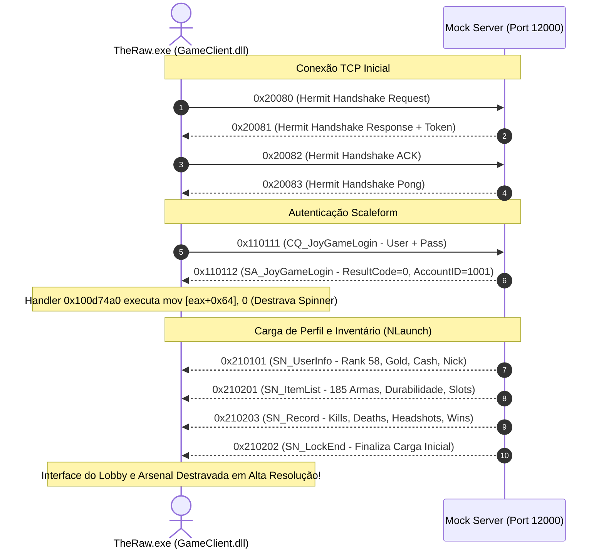

# Especificação Técnica do Protocolo de Rede — District 187: Sin Streets
**Alvo:** `targets/district-187/` (`TheRaw.exe`, `GameClient.dll`, `Engine_Server.dll`)  
**Data:** 2026-11-02  
**Status:** Mapeamento Completo (326 Pacotes Catalogados)  
**Ferramentas:** REA MCP, Ghidra 12.1.4, Python 3.13, PE Parser estático  

---

## 1. Visão Geral da Arquitetura de Rede

A camada de rede do District 187 (S2 Online / S2 Rebirth) é dividida em duas camadas fundamentais:
1. **Camada de Transporte e Cifra de Fluxo (Hermit Network Layer):**
   - Protocolo: TCP na porta `12000` (Lobby/Matchmaking) e UDP na porta `27888` (Gameplay/Batalha).
   - Cifra de Fluxo: Símbolo em `TheRaw.exe` em `VA 0x4ff470` / `0x4ff660`.
   - Máscara de Cifra: Operação XOR byte a byte usando a tabela IEEE 802.3 CRC32 (`VA 0x802a58`) indexada pelo byte inferior do contador de stream `i & 0xFF`, combinado com a chave mestre `0x0F`:
     $$C[i] = P[i] \oplus (\text{CRC\_TABLE}[i \ \& \ 0\text{xFF}] \ \& \ 0\text{xFF}) \oplus 0\text{x0F}$$
2. **Camada de Aplicação (Protocolo Orientado a Eventos `tPacket`):**
   - 326 tipos de pacotes mapeados em `GameClient.dll` (`VA 0x10056e00 - 0x10058500`).
   - Estrutura de enquadramento (Framing):
     ```
     [Total Length: uint32 (4 bytes)]
     [Opcode: uint32 (4 bytes)]
     [Payload: N bytes (Length - 8)]
     ```

---

## 2. Nomenclatura e Direcionamento de Pacotes

A engine utiliza convenções estritas nos identificadores dos pacotes:

| Prefixo | Significado | Descrição |
| :--- | :--- | :--- |
| **`CQ`** | Client Query | Requisição originada pelo cliente aguardando resposta do servidor. |
| **`SA`** | Server Answer | Resposta direta e autoritativa do servidor a uma `CQ`. |
| **`SN`** | Server Notification | Notificação assíncrona do servidor para o cliente (ex: abates, entrada de usuário na sala, entrega de itens). |
| **`CN`** | Client Notification | Ação unilateral do cliente enviada ao servidor (ex: botão Pronto, clique em Iniciar, comando de dev). |
| **`NN`** | Network Broadcast | Mensagem de difusão de canal ou sala (ex: mensagens de rádio e chat global). |

---

## 3. Famílias de Pacotes e Distribuição

A análise estática das 326 estruturas mapeou as seguintes famílias:



---

## 4. Ciclo de Vida da Sessão e Handshake

### 4.1 Sequência de Conexão e Desbloqueio da Interface (Scaleform UI)



---

## 5. Estruturas Binárias Principais

### 5.1 `SA_JoyGameLogin` (`0x110112`)
- **Tamanho do Payload:** 40 bytes
- **Campos:**
  - `ResultCode` (`uint32`): `0x00000000` (Sucesso). Qualquer valor diferente causa erro com código na tela.
  - `AccountID` (`uint32`): Identificador único da conta (ex: `1001`).
  - `Nickname` (`char[32]`): Nome de exibição preenchido com bytes nulos (`\x00`).

### 5.2 `SN_UserInfo` (`0x210101`)
- **Tamanho do Payload:** 88 bytes
- **Campos:**
  - `AccountID` (`uint32`): `1001`
  - `Rank` (`uint32`): `58` (*General of the Army*)
  - `Experience` (`uint64`): `50,000,000 XP`
  - `Gold` (`uint32`): `9,999,999`
  - `Cash` (`uint32`): `9,999,999`
  - `Nickname` (`char[32]`): Nickname do jogador
  - `ClanName` (`char[32]`): Nome do clã atribuído

### 5.3 `SN_ItemList` (`0x210201`)
- **Tamanho do Payload:** $4 + (10 \times N)$ bytes
- **Campos:**
  - `ItemCount` (`uint32`): Quantidade $N$ de itens carregados
  - Array de $N$ estruturas:
    - `ItemID` (`uint32`): ID correspondente em `targets/district-187/data/s2rebirth.db`
    - `ItemType` (`uint16`): `1` = Primária, `2` = Secundária, `3` = Melee, `4` = Granada, `5` = Equipamento VIP
    - `Durability` (`uint16`): `100` (100% integridade)
    - `EquippedSlot` (`int16`): `-1` para inventário, `0` para arma primária ativa, `1` para secundária, `2` para faca, `3` para granada.

### 5.4 `SN_LockEnd` (`0x210202`)
- **Tamanho do Payload:** 4 bytes (`uint32` = 0)
- **Função:** Sinaliza ao subsistema de interface Scaleform que todos os pacotes de dados da conta foram entregues, transicionando a tela para os menus funcionais de lobby, seleção de canais e customização de armas.

---

## 6. Arquivos e Implementações Relacionadas
- Script de Mapeamento: [`scripts/map_district187_protocol.py`](file:///C:/Users/dopamine/Desktop/Projetos/Reverse%20Engineering/scripts/map_district187_protocol.py)
- Serializador Python: [`scripts/d187_protocol.py`](file:///C:/Users/dopamine/Desktop/Projetos/Reverse%20Engineering/scripts/d187_protocol.py)
- Schema JSON: [`targets/district-187/data/d187_protocol_schema.json`](file:///C:/Users/dopamine/Desktop/Projetos/Reverse%20Engineering/targets/district-187/data/d187_protocol_schema.json)
