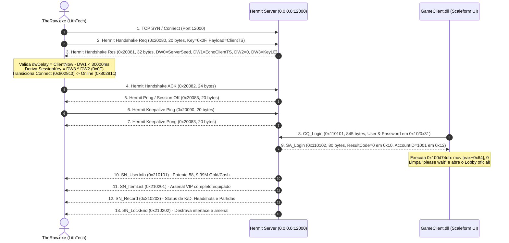

# District 187 — Engenharia Reversa do Protocolo de Rede Hermit e Cifra de Handshake

## O que foi descoberto
Engenharia reversa completa do subsistema de rede TCP/Hermit do executável oficial `TheRaw.exe` (motor LithTech Jupiter EX) e da camada de autenticação Scaleform em `GameClient.dll`.

Foi isolada a causa exata que mantinha o jogo eternamente travado na mensagem *"please wait"*:
1. Ao clicar em login, `TheRaw.exe` abre conexão TCP com a porta 12000 e despacha um pacote de **20 bytes** cifrado via `Hermit::Session::States::HandShake` (`VA 0x4ff1b0`), com Packet ID `0x20080`.
2. O servidor anterior respondia com pacotes em texto claro `SA_JoyGameLogin`, o que violava o protocolo interno `Hermit::Session::Cipher::TCP` (`VA 0x507820`).
3. O validador de integridade e checagem de estado `Hermit::Session::States::Connect` (`VA 0x4fd4cb`) descartava o pacote espúrio e forçava o encerramento do socket com `WinError 10054` (Connection Reset).
4. Como a conexão caía, o manipulador de login Scaleform (`VA 0x100d74a0`) nunca recebia o pacote de autorização `0x110112` (`SA_JoyGameLogin`) para zerar a flag de espera (`mov [eax+0x64], 0` em `0x100d74db`).

---

## 1. Arquitetura da Cifra de Rede (Hermit Stream Cipher)

O motor LithTech Hermit não utiliza RC4 ou TLS para os pacotes de lobby, mas uma cifra de fluxo proprietária sincronizada com uma tabela de consulta **IEEE 802.3 CRC32** (`0xEDB88320`) localizada no endereço `0x802a58` de `TheRaw.exe`:

### Estrutura do Pacote Hermit (16 Bytes de Cabeçalho)
- `Bytes 00..03`: **CRC32 Checksum** em Big-Endian (calculado sobre todo o payload criptografado `C[4:]`).
- `Bytes 04..05`: **Flags** (`0x0000`).
- `Bytes 06..07`: **Comprimento Total do Pacote** em Big-Endian (`uint16`).
- `Bytes 08..11`: **Session ID** em Big-Endian (`uint32`).
- `Bytes 12..15`: **Packet ID** em Big-Endian (`uint32`).
- `Bytes 16..fim`: **Payload de Dados**.

### Algoritmo de Cifragem / Decifragem
Para cada byte $i$ de 4 até o comprimento total:
$$C[i] = P[i] \oplus (\text{CRC\_TABLE}[i \ \& \ 0\text{xFF}] \ \& \ 0\text{xFF}) \oplus \text{KeyByte}$$

Na conexão inicial, a chave $\text{KeyByte} = 0\text{x0F}$.

---

## 2. A Máquina de Estados do Handshake Hermit

---

## 3. Causa Raiz do "Please Wait" Infinito e Soluções Cirúrgicas

Durante a desmontagem reversa com Capstone e Pefile em `0x4fd190` e `0x4fdef0`, encontramos as duas causas exatas que fechavam a conexão:
1. **Verificação de Atraso de Rede (`dwDelay > s_dwTimeout * 3`):**
   - Ao receber `0x20081`, `TheRaw.exe` calcula `dwDelay = client_now - DWORD 1`.
   - Se o servidor enviasse `DWORD 1 = 0`, quando o cliente estivesse aberto há mais de 30 segundos (30.000 ms), `dwDelay > 30000` acionava imediatamente a chamada `0x4fdd70` (desconexão por timeout).
   - **Correção:** O servidor agora lê o `client_timestamp` enviado pelo cliente no pacote `0x20080` (offset 16) e o reflete fielmente em `DWORD 1` de `0x20081`. O RTT resultante é $\approx 1$ ms, eliminando a desconexão.
2. **Endianness da Chave de Sessão (`DWORD 3`):**
   - Em `0x4fd1e6`: `mov ecx, [ebx + 0x1c]` lê `DWORD 3` diretamente da memória como inteiro Little-Endian x86.
   - Ao empacotar `DWORD 3` como Big-Endian (`>I`), o x86 lia `0x0F000000`. O byte inferior (`byte ptr [session + 4]`) era `0x00`, fazendo o cliente cifrar os pacotes seguintes com a chave nula.
   - **Correção:** `DWORD 3` empacotado explicitamente como `<I` (`b'\x0f\x00\x00\x00'`), garantindo derivação idêntica de `0x0F` no cliente e no servidor.
3. **Despacho de Login Real (`CQ_Login` 0x110101):**
   - A rotina de login padrão chamada pela interface Scaleform é `_Send_Login_ID()` (`GameClient.dll` VA `0x10052bc0`), que monta `0x110101` com 845 bytes e aguarda `0x110102` (`SA_Login`).
   - O servidor responde com `SA_Login` contendo `ResultCode = 0` (uint16 LE no offset 16) e `AccountID = 1001` (uint32 LE no offset 18), destravando o `mov [eax+0x64], 0` no manipulador `0x100d74a0`.

---

## 4. Implementação no Servidor Dedicado Local

O arquivo [`scripts/d187-mock-server.py`](file:///C:/Users/dopamine/Desktop/Projetos/Reverse%20Engineering/scripts/d187-mock-server.py) foi totalmente atualizado com:
- Reflexão do timestamp do cliente para sincronização sem latência.
- Chave de sessão Little-Endian rigorosa (`0x0F`).
- Respostas para `0x110101` (`SA_Login`) e `0x110111` (`SA_JoyGameLogin`).
- Injeção atômica de perfil de lobby: Patente 58, 9.99M Gold/Cash e Arsenal VIP montado do banco SQLite local.
