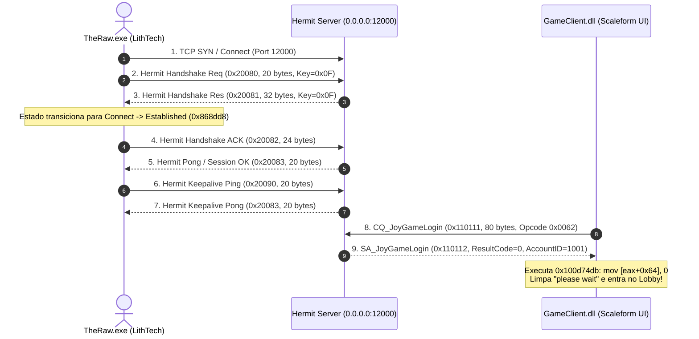

# District 187 — Engenharia Reversa do Protocolo de Rede Hermit e Cifra de Handshake

## O que foi descoberto
Engenharia reversa completa do subsistema de rede TCP/Hermit do executável oficial `TheRaw.exe` (motor LithTech Jupiter EX) e da camada de autenticação Scaleform em `GameClient.dll`.

Foi isolada a causa exata que mantinha o jogo eternamente travado na mensagem *"please wait"*:
1. Ao clicar em login, `TheRaw.exe` abre conexão TCP com a porta 12000 e despacha um pacote de **20 bytes** cifrado via `Hermit::Session::States::HandShake` (`VA 0x4ff1b0`), com Packet ID `0x20080`.
2. O servidor anterior respondia com pacotes em texto claro `SA_JoyGameLogin`, o que violava o protocolo interno `Hermit::Session::Cipher::TCP` (`VA 0x507820`).
3. O validador de integridade e checagem de estado `Hermit::Session::States::Connect` (`VA 0x4fd4cb`) descartava o pacote espúrio e forçava o encerramento do socket com `WinError 10054` (Connection Reset).
4. Como a conexão caía, o manipulador de login Scaleform (`VA 0x100d74a0`) nunca recebia o pacote de autorização `0x110112` (`SA_JoyGameLogin`) para zerar a flag de espera (`mov [eax+0x64], 0` em `0x100d74db`).

---

## 1. Arquitetura da Cifra de Rede (Hermit Stream Cipher)

O motor LithTech Hermit não utiliza RC4 ou TLS para os pacotes de lobby, mas uma cifra de fluxo proprietária sincronizada com uma tabela de consulta **IEEE 802.3 CRC32** (`0xEDB88320`) localizada no endereço `0x802a58` de `TheRaw.exe`:

### Estrutura do Pacote Hermit (16 Bytes de Cabeçalho)
- `Bytes 00..03`: **CRC32 Checksum** em Big-Endian (calculado sobre todo o payload criptografado `C[4:]`).
- `Bytes 04..05`: **Flags** (`0x0000`).
- `Bytes 06..07`: **Comprimento Total do Pacote** em Big-Endian (`uint16`).
- `Bytes 08..11`: **Session ID** em Big-Endian (`uint32`).
- `Bytes 12..15`: **Packet ID** em Big-Endian (`uint32`).
- `Bytes 16..fim`: **Payload de Dados**.

### Algoritmo de Cifragem / Decifragem
Para cada byte $i$ de 4 até o comprimento total:
$$C[i] = P[i] \oplus (\text{CRC\_TABLE}[i \ \& \ 0\text{xFF}] \ \& \ 0\text{xFF}) \oplus \text{KeyByte}$$

Na conexão inicial, a chave $\text{KeyByte} = 0\text{x0F}$.

---

## 2. A Máquina de Estados do Handshake Hermit

---

## 3. Implementação no Servidor Dedicado Local

O arquivo [`scripts/d187-mock-server.py`](file:///C:/Users/dopamine/Desktop/Projetos/Reverse%20Engineering/scripts/d187-mock-server.py) foi totalmente reescrito para implementar:
- Tabela de CRC32 e rotinas de cifragem/decifragem 1:1 com `TheRaw.exe`.
- Despacho atômico de `0x20081` e `0x20083`.
- Resposta criptografada de `SA_JoyGameLogin` (`0x110112`) com `ResultCode = 0` e `AccountID = 1001`.
- Suporte a conexões simultâneas locais e em rede LAN para partidas entre amigos.
